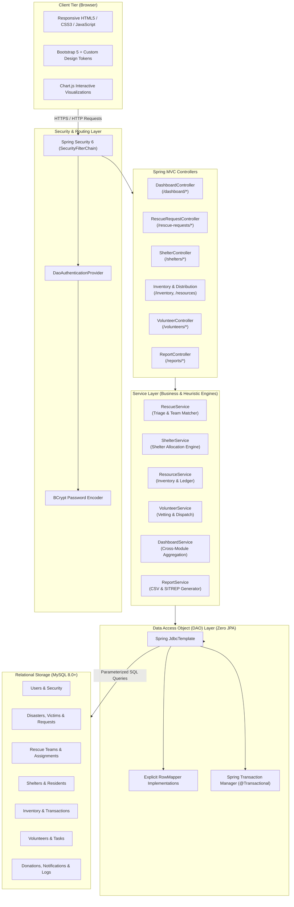
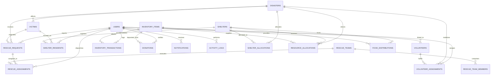

# ResQHub — Integrated Disaster Response Coordination System

<p align="center">
  
</p>

<p align="center">
  <strong>Integrated Disaster Response Coordination System</strong><br>
  <em>Help. Hope. Humanity.</em>
</p>

<p align="center">
  
  
  
  
  
  
  
  
  
  
</p>

---

## Table of Contents

- [Overview](#overview)
  - [Problem Statement](#problem-statement)
  - [Proposed Solution](#proposed-solution)
  - [Project Objectives](#project-objectives)
  - [Target Users & Use Cases](#target-users--use-cases)
- [Key Features](#key-features)
  - [Implemented Modules](#implemented-modules)
  - [Planned Enhancements](#planned-enhancements)
- [Deterministic Decision Engines](#deterministic-decision-engines)
  - [Dynamic Rescue Priority Calculation](#1-dynamic-rescue-priority-calculation)
  - [Smart Rescue Squad Recommendation Engine](#2-smart-rescue-squad-recommendation-engine)
  - [Smart Shelter Evacuation Matching Engine](#3-smart-shelter-evacuation-matching-engine)
- [User Roles and Permissions](#user-roles-and-permissions)
  - [Role Matrix & Dashboard Routes](#role-matrix--dashboard-routes)
  - [Admin Perspective Preview Feature](#admin-perspective-preview-feature)
  - [Role-Based User Profiles](#role-based-user-profiles)
- [Technology Stack](#technology-stack)
- [System Architecture](#system-architecture)
  - [Layered Architecture Diagram](#layered-architecture-diagram)
  - [Request Lifecycle](#request-lifecycle)
- [Project Structure](#project-structure)
- [Prerequisites](#prerequisites)
- [Installation and Setup](#installation-and-setup)
  - [Step 1: Clone Repository](#step-1-clone-repository)
  - [Step 2: Database Initialization](#step-2-database-initialization)
  - [Step 3: Environment Configuration](#step-3-environment-configuration)
  - [Step 4: Build the Project](#step-4-build-the-project)
  - [Step 5: Run the Application](#step-5-run-the-application)
- [Environment Configuration Reference](#environment-configuration-reference)
  - [Local vs. Cloud Configuration](#local-vs-cloud-configuration)
- [Database Documentation](#database-documentation)
  - [Verified Table Schema (19 Tables)](#verified-table-schema-19-tables)
  - [Entity Relationship Diagram](#entity-relationship-diagram)
- [Application Usage](#application-usage)
  - [Navigation and Core Workflows](#navigation-and-core-workflows)
- [Screenshots & UI Showcase](#screenshots--ui-showcase)
- [Testing & Quality Assurance](#testing--quality-assurance)
- [Deployment Guide](#deployment-guide)
  - [Local Production Jar](#local-production-jar)
  - [Cloud & Container Deployment Roadmap](#cloud--container-deployment-roadmap)
- [Security Considerations](#security-considerations)
- [Troubleshooting](#troubleshooting)
- [Future Roadmap](#future-roadmap)
- [Contributors](#contributors)
- [License](#license)
- [Acknowledgements](#acknowledgements)

---

## Overview

### Problem Statement
During large-scale natural disasters (e.g., flash floods, monsoonal landslides, cyclonic storm surges), communication lines break down, emergency dispatch centers become overwhelmed, and relief agencies operate in disconnected silos. Displaced citizens struggle to lodge distress calls, field rescue units lack situational visibility into victim urgency and terrain hazards, evacuation shelters suffer from uncoordinated over-crowding, and warehouse logistics misplace vital rations and emergency relief equipment.

### Proposed Solution
**ResQHub** (*Integrated Disaster Response Coordination System*) provides a unified, web-based emergency management platform connecting civil protection authorities, field rescue units, refugee shelter camp managers, vetted volunteers, and affected citizens under a synchronized command umbrella. 

ResQHub pairs strict role-based access controls with deterministic heuristic algorithms to prioritize trapped citizens, match qualified rescue squads based on specialized gear and geography, balance camp bed capacities, audit warehouse inventory transactions, and track public donations with receipt generation.

### Project Objectives
1. **Accelerate Extraction Timelines:** Provide citizen-facing emergency SOS submission with automated urgency triage scoring.
2. **Eliminate Operational Silos:** Consolidate disaster declaration, triage registries, squad assignments, camp occupancy, and inventory logistics in one accessible system.
3. **Transparent & Auditable Decision-Making:** Use deterministic, auditable mathematical formulas instead of opaque, non-deterministic AI for mission-critical squad dispatching and shelter allocation.
4. **Architectural Reliability:** Built on raw **Spring JDBC (`JdbcTemplate`)** with direct SQL queries and zero ORM overhead, guaranteeing predictable queries, transparent execution plans, and rock-solid relational integrity.
5. **Zero Paid External Dependencies:** Functions autonomously without paid commercial APIs, proprietary map trackers, or third-party cloud data harvesters.

### Target Users & Use Cases
- **Disaster Management Authorities (Admins):** Declare disasters, monitor cross-agency operational metrics, audit system activity logs, manage user access, and oversee financial/material donations.
- **Rescue Incident Commanders (Rescue Officers):** Triage emergency distress requests, evaluate squad readiness, match specialized rescue teams to hazard conditions, and monitor mission lifecycles.
- **Camp Superintendents (Camp Managers):** Track live bed capacities, register evacuee arrivals and check-outs, requisition warehouse supplies, and record meal batch distributions.
- **Field Volunteers:** Register skills, undergo administrative vetting, toggle duty status (`AVAILABLE` / `UNAVAILABLE`), and execute assigned field tasks.
- **Citizens & Affected Families:** Submit emergency rescue requests, search public shelters, track missing family members, register as volunteers, and contribute humanitarian donations.

---

## Key Features

### Implemented Modules

| Category | Module | Supported Functionality |
| :--- | :--- | :--- |
| **Authentication & RBAC** | User & Identity Management | BCrypt-hashed credentials (`$2a$10$`), Spring Security 6 authorization guards, account status toggles (`ACTIVE`/`INACTIVE`), and role assignment across 5 roles. |
| **Incident Command** | Disaster Management | Registry of active incidents (`FLOOD`, `EARTHQUAKE`, `LANDSLIDE`, `CYCLONE`, `FIRE`) with severity ratings (`CRITICAL`, `HIGH`, `MODERATE`, `LOW`) and operational constraints preventing accidental deletion of referenced records. |
| **Emergency Triage** | Rescue Requests & SOS | Public and authenticated SOS submission, automatic unique reference codes (`REQ-YYYY-XXXX`), priority calculation, officer verification, status progression (`PENDING` $\to$ `VERIFIED` $\to$ `ASSIGNED` $\to$ `IN_PROGRESS` $\to$ `COMPLETED`). |
| **Search & Extraction** | Rescue Teams & Dispatch | Rescue squad directory, operating area coverage, equipment capability tags (Swift-Water, Heavy Collapse, Medical), live readiness tracking, and assignment logging. |
| **Algorithmic Dispatch** | Smart Team Allocation | Deterministic, multi-factor scoring engine evaluating team availability, team capacity vs. victim group size, operating area proximity, and specialized hazard-matching gear. |
| **Victim Registry** | Victim Tracking & Reunification | Individual and family registration with auto-generated identifiers (`VIC-YYYY-XXXX`), special vulnerability tags (infant, elderly, mobility requirements), and rescue lifecycle tracking. |
| **Shelter Management** | Camp Directory & Evacuation | Shelter capacity tracking, real-time bed occupancy calculations, camp manager contact details, and dynamic status tags (`AVAILABLE`, `NEARLY_FULL`, `FULL`, `TEMPORARILY_CLOSED`). |
| **Shelter Logistics** | Resident Check-In & Check-Out | Idempotent check-in and check-out workflows for evacuees with automatic occupancy updates and disaster-camp linkage. |
| **Algorithmic Housing** | Smart Shelter Allocation | Multi-factor heuristic allocation engine evaluating projected post-occupancy buffer, camp operational status, and geographic locality keywords. |
| **Relief Logistics** | Inventory & Warehouse Stock | Central supply management across categories (`FOOD`, `DRINKING_WATER`, `CLOTHING`, `BLANKETS`, `HYGIENE_KITS`, `RESCUE_EQUIPMENT`), unit standards, low-stock threshold alerts, and warehouse bins. |
| **Audit Trail** | Inventory Transactions | Immutable ledger of all inventory adjustments (`RECEIVED`, `ISSUED`, `ALLOCATED`, `ADJUSTED`) with recorded user accountability. |
| **Supply Distribution** | Resource Allocations | Formal supply requests dispatched from central inventory to individual relief camps with lifecycle states (`PLANNED` $\to$ `APPROVED` $\to$ `DISPATCHED` $\to$ `DELIVERED`). |
| **Ration Operations** | Food Distribution Batches | Structured meal and ration distribution logging, tracking recipient headcounts, meal dates, relief camps, and associated inventory consumption. |
| **Community Force** | Volunteer Onboarding & Vetting | Public volunteer registration portal, administrative vetting workflow (`PENDING` $\to$ `APPROVED` / `REJECTED`), experience and skill tracking, and operational area tagging. |
| **Task Management** | Volunteer Mission Board | Task creation, dispatching, and volunteer-side lifecycle management (`PENDING` $\to$ `ACCEPTED` / `DECLINED` $\to$ `IN_PROGRESS` $\to$ `COMPLETED`) with field notes. |
| **Humanitarian Aid** | Donations & Receipts | Donor intake for monetary funds and physical relief materials, administrative verification, automatic inventory injection upon verification, and printable reference receipts. |
| **Analytics & SITREP** | Operational Reports & CSV | Incident dossier generator, printable Situation Reports (SITREP), filterable victim rosters, warehouse stock audits, and RFC-4180 compliant CSV data exports. |
| **Alerts & Audit** | In-App Notifications & Logs | Role-targeted and user-targeted notifications, unread count badge, and audit log tracking for all critical system mutations. |

### Planned Enhancements
- [ ] Offline-first mobile Progressive Web App (PWA) client for field rescue units in zero-connectivity areas.
- [ ] OpenStreetMap / Leaflet GIS interactive map visualization with spatial hazard boundary overlays.
- [ ] Automated SMS gateway integration for offline citizen SOS broadcasting.
- [ ] Two-factor authentication (2FA / TOTP) for administrative command actions.

---

## Deterministic Decision Engines

ResQHub intentionally rejects non-deterministic "black-box" models for emergency management, utilizing **transparent, deterministic, auditable heuristic algorithms** implemented directly in Java services.

### 1. Dynamic Rescue Priority Calculation
*Implemented in `RescueServiceImpl.calculatePriority(Urgency, int, Long)`*

When an emergency SOS is lodged, the system computes a composite triage priority score:

$$\text{Triage Score} = \text{Urgency Score} + \text{Group Size Score} + \text{Disaster Severity Score}$$

| Component | Condition / Value | Score Contribution |
| :--- | :--- | :--- |
| **Urgency Weight** | `CRITICAL` <br> `HIGH` <br> `MEDIUM` <br> `LOW` | **+40 pts** <br> **+25 pts** <br> **+15 pts** <br> **+5 pts** |
| **Group Size Factor** | $> 10$ people <br> $> 5$ people <br> $> 2$ people <br> Single individual | **+30 pts** <br> **+20 pts** <br> **+10 pts** <br> **+5 pts** |
| **Disaster Severity** | Disaster `CRITICAL` <br> Disaster `HIGH` <br> Disaster `MODERATE` <br> Disaster `LOW` | **+20 pts** <br> **+15 pts** <br> **+10 pts** <br> **+5 pts** |

**Priority Classification:**
- **$\text{Triage Score} \ge 70$** $\longrightarrow$ `CRITICAL`
- **$45 \le \text{Triage Score} < 70$** $\longrightarrow$ `HIGH`
- **$25 \le \text{Triage Score} < 45$** $\longrightarrow$ `MEDIUM`
- **$\text{Triage Score} < 25$** $\longrightarrow$ `LOW`

---

### 2. Smart Rescue Squad Recommendation Engine
*Implemented in `RescueServiceImpl.getRecommendedTeams(Long requestId)`*

Evaluates active rescue squads against incident requirements and ranks them on a 100-point scale:

$$\text{Squad Match Score} = \text{Availability} + \text{Capacity Suitability} + \text{Proximity} + \text{Hazard Specialty}$$

1. **Availability Constraint (25 pts):**
   - Team status `AVAILABLE`: **+25 pts** (Eligible).
   - Team status `ASSIGNED` / `ON_OPERATION` / `UNAVAILABLE`: **0 pts** (Flagged as *Ineligible* for new dispatch).
2. **Capacity Suitability (15 pts):**
   - Squad capacity $\ge$ Trapped people count: **+15 pts**.
   - Squad capacity $<$ Trapped people count: **0 pts** (Flagged as *Capacity Ineligible*).
3. **Proximity & Sector Match (Up to 30 pts):**
   - Team designated operating sector matches request location or disaster zone: **+30 pts**.
   - Adjacent or secondary operational zone: **+10 pts**.
4. **Hazard Specialty Match (Up to 25 pts):**
   - For `FLOOD` or `CYCLONE`: Squad possesses *water*, *boat*, *dive*, or *swift-water* gear $\longrightarrow$ **+25 pts**.
   - For `LANDSLIDE` or `EARTHQUAKE`: Squad possesses *rope*, *rigging*, *debris*, or *mountain* training $\longrightarrow$ **+25 pts**.
   - General trauma / *medical* / *first-aid* / *cpr* capability $\longrightarrow$ **+15 pts**.

---

### 3. Smart Shelter Evacuation Matching Engine
*Implemented in `ShelterServiceImpl.recommendShelters(Long disasterId, int peopleCount)`*

Calculates the optimal evacuation camp for evacuee cohorts:

$$\text{Shelter Match Score} = \text{Capacity Buffer (40 pts)} + \text{Operational Status (30 pts)} + \text{Location Affinity (30 pts)}$$

1. **Capacity Buffer (Up to 40 pts):**
   - Evaluates projected post-arrival occupancy: $\text{Projected \%} = \frac{\text{Current Occupancy} + \text{Group Count}}{\text{Total Capacity}} \times 100$
   - $\text{Projected \%} \le 70\%$: **+40 pts** (Ample buffer).
   - $70\% < \text{Projected \%} \le 90\%$: **+30 pts** (Moderate buffer).
   - $\text{Projected \%} > 90\%$: **+15 pts** (Tight buffer).
   - *Shelters with remaining beds $<$ requested count are disqualified.*
2. **Operational Status (Up to 30 pts):**
   - `AVAILABLE`: **+30 pts**.
   - `NEARLY_FULL`: **+15 pts**.
   - *`TEMPORARILY_CLOSED` shelters are strictly excluded.*
3. **Location Affinity (Up to 30 pts):**
   - Proximity keyword match between disaster locality and shelter address: **+30 pts**.
   - General operational shelter without immediate keyword match: **+15 pts**.

---

## User Roles and Permissions

### Role Matrix & Dashboard Routes

ResQHub defines 5 distinct user roles governed by Spring Security `@PreAuthorize` method security and URL authorization rules in `SecurityConfig.java`:

| Role Name | Authority String | Primary Dashboard Route | Permissions & Responsibilities |
| :--- | :--- | :--- | :--- |
| **System Administrator** | `ROLE_ADMIN` | `/dashboard/admin` | Full system control, user provisioning and status toggles, disaster declaration, donation verification, activity audit logs, and global situation reports. |
| **Field Rescue Officer** | `ROLE_RESCUE_OFFICER` | `/dashboard/rescue-officer` | Incident intake, victim triage, rescue request verification, squad dispatching, smart team allocation execution, and mission completion logging. |
| **Camp Manager** | `ROLE_CAMP_MANAGER` | `/dashboard/camp-manager` | Shelter capacity oversight, evacuee resident check-in/out, smart shelter routing, inventory threshold monitoring, resource allocation requisitions, and food distributions. |
| **Field Volunteer** | `ROLE_VOLUNTEER` | `/dashboard/volunteer` | Duty availability toggle (`On-Duty` / `Off-Duty`), volunteer task board (`/volunteers/my-assignments`), task lifecycle actions (`Accept`, `Decline`, `Start`, `Complete`). |
| **Citizen** | `ROLE_CITIZEN` | `/dashboard/citizen` | Public emergency SOS submission, personal request tracking (`/rescue-requests/my-requests`), public shelter directory search, volunteer sign-up, and humanitarian donations. |

### Admin Perspective Preview Feature
System Administrators have the exclusive ability to simulate and inspect the operational perspectives of other roles directly from the interface:
- **Preview Rescue Officer:** `/dashboard/rescue-officer`
- **Preview Camp Manager:** `/dashboard/camp-manager`
- **Preview Volunteer:** `/dashboard/volunteer`
- **Preview Citizen:** `/dashboard/citizen`
- **Exit Preview:** `/dashboard/exit-preview` (Restores full admin dashboard session)

### Role-Based User Profiles
For development and evaluation, reference user profiles corresponding to each system role are provisioned through the database initialization script ([database/sample-data.sql](database/sample-data.sql)).

| Role Name | Authority String | Standard Username | Primary Operational Function |
| :--- | :--- | :--- | :--- |
| **System Administrator** | `ROLE_ADMIN` | `admin` | Unified Command Center, Disaster Declaration & User Management |
| **Field Rescue Officer** | `ROLE_RESCUE_OFFICER` | `rescue_officer` | Emergency Triage, Squad Dispatching & Smart Team Allocation |
| **Camp Manager** | `ROLE_CAMP_MANAGER` | `camp_manager` | Camp Operations, Bed Occupancy & Supply Requisitions |
| **Field Volunteer** | `ROLE_VOLUNTEER` | `volunteer_user` | Duty Availability & Mission Task Board |
| **Citizen** | `ROLE_CITIZEN` | `citizen_user` | SOS Emergency Submission, Public Shelter Lookup & Donations |

> **Security Note:** In accordance with security best practices, passwords, private keys, and cryptographic hashes are never committed to documentation or public repositories. Initial passwords should be set via environment variables or managed securely within your local database environment.

---

## Technology Stack

```
================================================================================
                                CORE BACKEND
================================================================================
Java Development Kit (JDK)   : OpenJDK 17 (LTS)
Application Framework        : Spring Boot 3.2.4
Web & MVC Engine             : Spring MVC (spring-boot-starter-web)
Security Architecture        : Spring Security 6 (BCrypt Password Hashing, RBAC)
Persistence Layer            : Spring JDBC (JdbcTemplate, RowMapper, @Transactional)
Connection Pooling           : HikariCP (Connection management, 10 max pool)
Input Validation             : Jakarta Bean Validation (Hibernate Validator)
Build & Dependency Tool      : Apache Maven 3.8+

================================================================================
                               DATABASE ENGINE
================================================================================
RDBMS                        : MySQL 8.0+ / MySQL 8.x
Driver                       : MySQL Connector/J (com.mysql:mysql-connector-j)
Design Philosophy            : Strict Relational Schema (19 Tables, Foreign Keys,
                               Indexes, ON DELETE RESTRICT guards, Zero JPA ORM)

================================================================================
                              FRONTEND & UI SYSTEM
================================================================================
Template Engine              : Thymeleaf 3 (with thymeleaf-extras-springsecurity6)
Component Framework          : Bootstrap 5.3 (Responsive Grid, Modals, Forms)
Icons                        : Bootstrap Icons 1.11+
Charting & Visualizations    : Chart.js 4.x (Client-side interactive charts)
Custom Design Tokens         : Forest Green (#1E5631), Earthy Brown (#7F5539),
                               Sand Neutral (#F4F6F4), Alert Crimson (#D90429)

================================================================================
                         TESTING & QUALITY ASSURANCE
================================================================================
Test Framework               : JUnit 5 (Jupiter), Spring Boot Starter Test
Mocking & Assertions         : Mockito, AssertJ, Spring Security Test
================================================================================
```

---

## System Architecture

### Layered Architecture Diagram

ResQHub adheres to a clean, decoupled MVC + Service + DAO architectural model. Business logic resides strictly within the service layer, while the data access layer relies entirely on parameterized queries executed through Spring's `JdbcTemplate`.



### Request Lifecycle
1. **Request Intake:** An incoming HTTP request passes through Spring Security filter chains verifying authentication cookies (`JSESSIONID`) and role permissions.
2. **Controller Routing:** The matching Spring MVC controller intercepts the request, validates input DTOs using Jakarta Validation (`@Valid`), and binds context attributes via `GlobalModelAttributes`.
3. **Business Processing:** Controllers delegate execution to transactional services (`@Transactional`). Services execute deterministic heuristic calculations (e.g., triage prioritization or squad scoring).
4. **Data Access (JdbcTemplate):** DAO implementations execute direct, parameterized SQL statements through `JdbcTemplate`, preventing SQL injection and transforming result sets via custom `RowMapper` objects into POJO entities.
5. **View Rendering:** Thymeleaf engine renders the final HTML page by injecting model attributes into modular fragment layouts (`navbar.html`, `sidebar.html`, `footer.html`) for browser presentation.

---

## Project Structure

```
ResQHub/
├── .env.example                               # Safe environment variable configuration template
├── .gitignore                                 # Git ignore definitions (build targets, logs, .env)
├── pom.xml                                    # Apache Maven build configuration & dependencies
├── README.md                                  # Project documentation
│
├── database/                                  # Database schema and initial data scripts
│   ├── schema.sql                             # 19 MySQL table definitions with indexes & constraints
│   └── sample-data.sql                        # Demonstration dataset (Kerala context, seeded users)
│
└── src/
    ├── main/
    │   ├── java/com/resqhub/
    │   │   ├── ResQHubApplication.java        # Spring Boot main application entrypoint
    │   │   │
    │   │   ├── config/                        # Security and global web configuration
    │   │   │   ├── SecurityConfig.java        # Spring Security 6 filter chain, RBAC & BCrypt
    │   │   │   └── GlobalModelAttributes.java # Injects sidebar badges, counts & user details
    │   │   │
    │   │   ├── controller/                    # Spring MVC web controllers (15 controllers)
    │   │   │   ├── AdminUserController.java   # Admin user management & audit log browser
    │   │   │   ├── AuthController.java        # Login, registration, role redirection
    │   │   │   ├── DashboardController.java   # 5 dedicated role dashboards & perspective switch
    │   │   │   ├── DisasterController.java    # Disaster incident CRUD & status toggles
    │   │   │   ├── DistributionController.java# Supply allocations & meal distributions
    │   │   │   ├── DonationController.java    # Donation intake, verification & receipts
    │   │   │   ├── HomeController.java        # Public emergency landing page
    │   │   │   ├── InventoryController.java   # Central warehouse inventory & stock adjustments
    │   │   │   ├── NotificationController.java# In-app notifications & read markers
    │   │   │   ├── ReportController.java      # Incident dossier & RFC-4180 CSV exports
    │   │   │   ├── RescueRequestController.java# Citizen SOS intake & smart squad dispatch
    │   │   │   ├── RescueTeamController.java   # Rescue squads directory & readiness
    │   │   │   ├── ShelterController.java     # Camps, resident check-in/out & smart routing
    │   │   │   ├── VictimController.java      # Evacuee / victim registry & search
    │   │   │   └── VolunteerController.java   # Public registration, task board & vetting
    │   │   │
    │   │   ├── dao/                           # Data Access Object interfaces & implementations
    │   │   │   ├── *Dao.java                  # DAO interfaces (User, Disaster, Shelter, etc.)
    │   │   │   └── impl/                      # JdbcTemplate implementations with RowMappers
    │   │   │
    │   │   ├── dto/                           # Data Transfer Objects & recommendation models
    │   │   │   ├── dashboard/                 # Role-specific dashboard statistics DTOs
    │   │   │   ├── report/                    # Incident and situation report DTOs
    │   │   │   ├── TeamRecommendation.java    # Rescue squad recommendation score container
    │   │   │   └── ShelterRecommendation.java # Evacuation camp recommendation score container
    │   │   │
    │   │   ├── model/                         # Domain entities & enumerated status types (43 files)
    │   │   │   ├── Disaster.java, Victim.java, RescueRequest.java, RescueTeam.java...
    │   │   │   └── Role.java, Severity.java, Urgency.java, VictimPriority.java...
    │   │   │
    │   │   └── service/                       # Business logic services & heuristic engines
    │   │       ├── *Service.java              # Service interfaces
    │   │       └── impl/                      # Transactional implementations
    │   │
    │   └── resources/
    │       ├── application.properties         # Server port, datasource config, Hikari pool
    │       ├── static/                        # Web assets
    │       │   ├── css/resqhub.css            # Custom styling & CSS variables
    │       │   ├── js/                        # Client-side scripts & Chart.js helpers
    │       │   └── images/logo.svg            # ResQHub brand SVG logo
    │       │
    │       └── templates/                     # Thymeleaf HTML5 templates
    │           ├── layout/                    # Modular fragments (navbar, sidebar, footer)
    │           ├── dashboard/                 # 5 role-specific dashboard views
    │           ├── disasters/, victims/, rescue-requests/, rescue-teams/...
    │           ├── shelters/, resources/, volunteers/, donations/, reports/...
    │           └── landing.html               # Public emergency portal landing page
    │
    └── test/java/com/resqhub/                 # Automated test suite (JUnit 5 + Mockito)
        ├── ResQHubApplicationTests.java
        └── service/                           # 11 Service unit & integration test classes
```

---

## Prerequisites

Ensure your environment satisfies the following requirements before installing:

| Prerequisite | Minimum Supported Version | Recommended Version | Verification Command |
| :--- | :--- | :--- | :--- |
| **Java Development Kit (JDK)** | OpenJDK 17 | OpenJDK 17 (Eclipse Temurin or Oracle) | `java -version` |
| **Apache Maven** | Maven 3.8.x | Maven 3.9+ | `mvn -v` |
| **MySQL Server** | MySQL 8.0.x | MySQL 8.0.32+ or MySQL 8.4 LTS | `mysql --version` |
| **Git Version Control** | Git 2.30+ | Latest Stable Git | `git --version` |

---

## Installation and Setup

### Step 1: Clone Repository
Clone the repository using Git and navigate to the project root directory:
```powershell
# In Windows PowerShell:
git clone https://github.com/rafasidhik/ResQHub.git
cd ResQHub
```

### Step 2: Database Initialization
Ensure your local MySQL service is running on port `3306`. Create the database schema and load the demonstration sample records:

```powershell
# Execute using MySQL CLI:
mysql -u root -p -e "CREATE DATABASE IF NOT EXISTS resqhub CHARACTER SET utf8mb4 COLLATE utf8mb4_unicode_ci;"

# Import the schema (19 tables with indexes and constraints):
mysql -u root -p resqhub < database\schema.sql

# Import seed demonstration data:
mysql -u root -p resqhub < database\sample-data.sql
```

> **Alternative (MySQL Workbench / DBeaver):**  
> Open and execute [database/schema.sql](database/schema.sql), followed by [database/sample-data.sql](database/sample-data.sql).

### Step 3: Environment Configuration
Create your local environment configuration file from the template:
```powershell
Copy-Item .env.example .env
```

Set your local database credentials via environment variables or configure them in your terminal session:
```powershell
# Windows PowerShell:
$env:DB_URL = "jdbc:mysql://localhost:3306/resqhub?useSSL=false&serverTimezone=UTC&allowPublicKeyRetrieval=true"
$env:DB_USERNAME = "root"
$env:DB_PASSWORD = "YourSecureMySQLPassword"
$env:SERVER_PORT = "8085"
```

```bash
# Linux / macOS Bash:
export DB_URL="jdbc:mysql://localhost:3306/resqhub?useSSL=false&serverTimezone=UTC&allowPublicKeyRetrieval=true"
export DB_USERNAME="root"
export DB_PASSWORD="YourSecureMySQLPassword"
export SERVER_PORT="8085"
```

### Step 4: Build the Project
Compile the source code and package the Spring Boot executable JAR:
```powershell
mvn clean package -DskipTests
```

### Step 5: Run the Application
Start the application using Maven:
```powershell
mvn spring-boot:run
```

Or execute the packaged production JAR directly:
```powershell
java -jar target/resqhub-1.0.0.jar
```

Once started, open your web browser and navigate to:
```
http://localhost:8085
```

---

## Environment Configuration Reference

The application dynamically reads configuration variables defined in [src/main/resources/application.properties](src/main/resources/application.properties):

| Variable Name | Default Fallback | Purpose & Guidance |
| :--- | :--- | :--- |
| `SERVER_PORT` | `8085` | The local or container HTTP listening port. |
| `DB_URL` | Cloud / Local MySQL URL | Complete JDBC connection string with encoding & SSL parameters. |
| `DB_USERNAME` | `root` (or configured DB user) | MySQL database user with standard application privileges. |
| `DB_PASSWORD` | *(None — must be supplied)* | Database password. **Never commit real credentials to source control.** |

### Local vs. Cloud Configuration

#### A. Standard Local MySQL (Recommended for local evaluation)
```properties
DB_URL=jdbc:mysql://localhost:3306/resqhub?useSSL=false&serverTimezone=UTC&allowPublicKeyRetrieval=true
DB_USERNAME=root
DB_PASSWORD=YourLocalPassword
SERVER_PORT=8085
```

#### B. Cloud Managed MySQL (e.g., Aiven, AWS RDS, DigitalOcean)
Cloud providers require mandatory SSL encryption. Append `sslMode=REQUIRED` or `useSSL=true`:
```properties
DB_URL=jdbc:mysql://<cloud-host>:<port>/resqhub?sslMode=REQUIRED&serverTimezone=UTC&characterEncoding=UTF-8
DB_USERNAME=<cloud-user>
DB_PASSWORD=<cloud-password>
SERVER_PORT=8085
```

---

## Database Documentation

### Verified Table Schema (19 Tables)

The ResQHub database schema ([database/schema.sql](database/schema.sql)) is strictly relational, normalized to 3NF, and enforces explicit foreign keys and composite indexes:

| # | Table Name | Description | Key Foreign Keys & Constraints |
| :---: | :--- | :--- | :--- |
| 1 | `users` | User accounts, credentials, contact details, and role assignments. | Unique: `username`, `email`. Role ENUM: `ADMIN`, `RESCUE_OFFICER`, `CAMP_MANAGER`, `VOLUNTEER`, `CITIZEN`. |
| 2 | `disasters` | Active disaster registry with severity, type, and geographic boundaries. | Type ENUM: `FLOOD`, `EARTHQUAKE`, `LANDSLIDE`, `CYCLONE`, `FIRE`. Status: `ACTIVE`, `CONTAINED`, `CLOSED`. |
| 3 | `victims` | Evacuee and victim profiles, family units, and medical/accessibility tags. | FK: `disaster_id` $\to$ `disasters(id)`. Unique: `reference_number`. |
| 4 | `rescue_requests` | Emergency distress calls, location, group count, urgency, and priority. | FK: `disaster_id`, `victim_id`, `reported_by_user_id`. Unique: `request_number`. |
| 5 | `rescue_teams` | Specialized rescue squads, leaders, operating areas, and capacity. | Unique: `team_identifier`. Availability: `AVAILABLE`, `ASSIGNED`, `ON_OPERATION`, `UNAVAILABLE`. |
| 6 | `rescue_team_members`| Individual squad personnel, specialized skills, and operational roles. | FK: `team_id` $\to$ `rescue_teams(id)` (ON DELETE CASCADE). |
| 7 | `rescue_assignments` | Mission dispatch records pairing squads with emergency requests. | FK: `request_id`, `team_id`, `assigned_by_user_id`. Status progression. |
| 8 | `shelters` | Relief camps, maximum bed capacity, live occupancy, and contact persons. | Unique: `shelter_identifier`. Status: `AVAILABLE`, `NEARLY_FULL`, `FULL`, `TEMPORARILY_CLOSED`. |
| 9 | `shelter_residents` | Evacuee check-in and check-out logs tracking bed allocation. | FK: `shelter_id`, `victim_id`, `disaster_id`, `registered_by_user_id`. |
| 10 | `shelter_allocations` | Formal evacuee cohort allocation records recommended by algorithm. | FK: `shelter_id`, `disaster_id`, `decided_by_user_id`. |
| 11 | `volunteers` | Community volunteer profiles, skills, vetting status, and background. | FK: `user_id` $\to$ `users(id)`. Approval: `PENDING`, `APPROVED`, `REJECTED`. |
| 12 | `volunteer_assignments`| Field mission task assignments dispatched to approved volunteers. | FK: `volunteer_id`, `disaster_id`, `assigned_by_user_id`. Priority: `LOW`, `MEDIUM`, `HIGH`. |
| 13 | `inventory_items` | Central relief warehouse stock catalog, categories, and low-stock limits. | Categories: `FOOD`, `DRINKING_WATER`, `CLOTHING`, `BLANKETS`, `HYGIENE_KITS`, `RESCUE_EQUIPMENT`. |
| 14 | `inventory_transactions`| Immutable stock adjustment audit ledger (`RECEIVED`, `ISSUED`, `ALLOCATED`). | FK: `item_id`, `performed_by_user_id`. Records quantity and rationale. |
| 15 | `resource_allocations`| Formal relief item supply consignments dispatched to shelters. | FK: `item_id`, `disaster_id`, `shelter_id`, `allocated_by_user_id`. |
| 16 | `food_distributions` | Daily meal and food batch distribution tracking headcounts and shelters. | FK: `shelter_id`, `item_id`. Distribution status tracking. |
| 17 | `donations` | Monetary and material relief donation ledger with verification state. | FK: `item_id`, `verified_by_user_id`. Unique: `donation_reference`. |
| 18 | `notifications` | System notifications targeted to specific users or broadcast roles. | FK: `user_id` (ON DELETE CASCADE). Read status tracking. |
| 19 | `activity_logs` | Immutable audit trail recording administrative actions across modules. | FK: `user_id`. Records module, action, affected record ID, timestamp. |

---

### Entity Relationship Diagram



---

## Application Usage

### Navigation and Core Workflows

1. **Accessing the System:**
   - Navigate to `http://localhost:8085`.
   - The public landing page displays live emergency statistics, active disaster summaries, emergency hotline details, and public shelter listings without requiring authentication.
2. **Citizen Emergency Workflow:**
   - Citizens can click **Request Immediate Rescue (SOS)** to submit emergency distress requests directly.
   - Citizens can browse available shelters, register as volunteers, or make financial/material donations.
3. **Rescue Coordination Workflow:**
   - Log in with a user account possessing the `RESCUE_OFFICER` role (e.g., `rescue_officer`).
   - Navigate to `/rescue-requests` to review incoming calls.
   - Click **Verify** to validate a pending call, then click **Smart Team Allocation** to run the matching engine and dispatch the most qualified rescue squad.
4. **Shelter & Camp Operations Workflow:**
   - Log in with a user account possessing the `CAMP_MANAGER` role (e.g., `camp_manager`).
   - View `/shelters` to inspect live camp bed occupancy meters.
   - Check-in arriving evacuees at `/shelters/{id}` to automatically update remaining bed counts.
   - Request inventory consignments from the central warehouse at `/resources/allocations/new`.
5. **Volunteer Task Lifecycle:**
   - Log in with a user account possessing the `VOLUNTEER` role (e.g., `volunteer_user`).
   - Toggle duty availability (`On-Duty` / `Off-Duty`).
   - Navigate to **Task Assignments** (`/volunteers/my-assignments`) to review assigned tasks.
   - Step through the task lifecycle: **Accept** $\to$ **Start Task** $\to$ **Log Progress** $\to$ **Complete Task**.
6. **Unified Administrative Command:**
   - Log in with a user account possessing the `ADMIN` role (e.g., `admin`).
   - Review cross-agency emergency KPIs, verify incoming public donations, audit warehouse transactions, and inspect activity logs.
   - Export official Situation Reports (SITREP) and RFC-4180 CSV rosters under `/reports`.

---

## Screenshots & UI Showcase

*The application features a responsive Bootstrap 5 interface tailored with earthy forest tones (`#1E5631`, `#7F5539`) and interactive Chart.js visualizations.*

| Interface View | Description & Module Route | Visual Preview Placeholder |
| :--- | :--- | :---: |
| **Unified Command Dashboard** | Real-time situation overview with active disaster counters, rescue progression meters, shelter occupancy gauges, and inventory status. (`/dashboard/admin`) | ```[ Screenshot: Admin Command Center ]``` |
| **Field Rescue Command** | High-priority SOS rescue queue, team availability board, and dispatch triggers. (`/dashboard/rescue-officer`) | ```[ Screenshot: Rescue Command Dashboard ]``` |
| **Smart Squad Allocation** | Algorithmic squad matching screen displaying proximity, gear compatibility, and match scores. (`/rescue-requests/smart-allocation`) | ```[ Screenshot: Smart Team Matcher ]``` |
| **Shelter & Camp Directory** | Live camp capacity progress bars, contact cards, and evacuee check-in actions. (`/shelters`) | ```[ Screenshot: Shelter Capacity Operations ]``` |
| **Volunteer Mission Board** | Duty status toggle and step-by-step task assignment lifecycle board. (`/volunteers/my-assignments`) | ```[ Screenshot: Volunteer Mission Board ]``` |
| **Citizen Emergency SOS** | Simple, streamlined emergency rescue request form with urgency indicators. (`/rescue-requests/new`) | ```[ Screenshot: Citizen SOS Intake ]``` |

> *To capture and add actual screenshots to your local repository, save your PNG/WebP images to `src/main/resources/static/images/screenshots/` and update these markdown links.*

---

## Testing & Quality Assurance

ResQHub includes a comprehensive automated test suite built with **JUnit 5**, **Mockito**, and **Spring Boot Test**. The test suite validates business rules, transaction boundaries, deterministic scoring algorithms, and security permissions across 11 service test classes.

```powershell
# Run all unit and integration tests:
mvn clean test
```

### Verified Test Classes:
- [VolunteerServiceTest.java](src/test/java/com/resqhub/service/VolunteerServiceTest.java): Task acceptance, task lifecycle, volunteer vetting, availability toggles.
- [VictimServiceTest.java](src/test/java/com/resqhub/service/VictimServiceTest.java): Auto-generated victim IDs, priority triage, search filters.
- [UserServiceTest.java](src/test/java/com/resqhub/service/UserServiceTest.java): User registration, BCrypt password hashing, role lookup.
- [ShelterServiceTest.java](src/test/java/com/resqhub/service/ShelterServiceTest.java): Bed occupancy synchronization, resident check-in/out, heuristic shelter allocation scoring.
- [ResourceServiceTest.java](src/test/java/com/resqhub/service/ResourceServiceTest.java): Inventory stock adjustments, transaction logging, threshold checks, food distributions.
- [RescueServiceTest.java](src/test/java/com/resqhub/service/RescueServiceTest.java): Triage priority calculation, smart squad matching score, dispatch progression.
- [ReportServiceTest.java](src/test/java/com/resqhub/service/ReportServiceTest.java): Incident summary report generation, CSV export data formatting.
- [NotificationServiceTest.java](src/test/java/com/resqhub/service/NotificationServiceTest.java): Role broadcast notifications, user notifications, unread count tracking.
- [DonationServiceTest.java](src/test/java/com/resqhub/service/DonationServiceTest.java): Monetary and material donation verification, automatic warehouse inventory injection.
- [DisasterServiceTest.java](src/test/java/com/resqhub/service/DisasterServiceTest.java): Disaster creation, operational status lifecycle, active incident filters.
- [DashboardServiceTest.java](src/test/java/com/resqhub/service/DashboardServiceTest.java): Cross-module statistics aggregation across all 5 user roles.

---

## Deployment Guide

### Local Production Jar
1. Build the self-contained executable jar:
   ```powershell
   mvn clean package -DskipTests
   ```
2. Run with production settings:
   ```powershell
   java -jar -Dspring.profiles.active=prod target/resqhub-1.0.0.jar
   ```

### Cloud & Container Deployment Roadmap

While ResQHub is currently verified and runnable as a standalone Spring Boot application, production deployment to cloud infrastructure requires the following standard architecture:

```
[ Internet / Citizens / Relief Agencies ]
                   │
                   ▼ (HTTPS : 443)
      [ Reverse Proxy: Nginx / Caddy ]
          - SSL/TLS Termination (Let's Encrypt)
          - Gzip / Brotli Compression
          - Rate Limiting (DDoS Protection)
                   │
                   ▼ (HTTP : 8085)
     [ ResQHub Spring Boot Application ]
          - Containerized (Docker / OCI)
          - HikariCP Connection Pool (Max 10)
                   │
                   ▼ (MySQL Protocol / TLS : 3306)
  [ Managed MySQL 8.0 Cluster (AWS RDS / Aiven) ]
          - Automated Backups & WAL Archiving
          - Private VPC Subnet
```

#### Production Considerations:
1. **Containerization (Docker):** Package the application using an OpenJDK 17 slim base image (`eclipse-temurin:17-jre-alpine`).
2. **Secret Management:** Inject database credentials and server settings via environment variables (`DB_URL`, `DB_USERNAME`, `DB_PASSWORD`) using Kubernetes Secrets or Docker Compose environment files.
3. **SSL/TLS Termination:** Terminate HTTPS via an Nginx reverse proxy with valid TLS certificates.
4. **Database Backups:** Configure daily logical database dumps (`mysqldump`) and write-ahead log archiving for disaster recovery.

---

## Security Considerations

- **Password Protection:** Passwords are cryptographically hashed using **BCrypt** with an adaptive work factor ($2^{10}$ rounds). Cleartext passwords are never stored in memory or persisted.
- **Role-Based Access Control (RBAC):** Strict endpoint protection via Spring Security method annotations (`@PreAuthorize("hasRole('ADMIN')")`, `@PreAuthorize("hasAnyRole(...)")`) and URL matchers.
- **SQL Injection Prevention:** The data access tier relies 100% on **parameterized SQL queries** via Spring's `JdbcTemplate`. No dynamic string concatenation is used for SQL execution.
- **Cross-Site Request Forgery (CSRF):** Form mutations enforce Spring Security CSRF tokens (`_csrf`).
- **Input Validation:** All client inputs are sanitized and validated against Jakarta Bean Validation constraints (`@NotBlank`, `@NotNull`, `@Size`, `@Min`).
- **Activity Audit Trail:** Sensitive actions (user status changes, disaster closure, donation verification, resident check-in) are immutably logged in the `activity_logs` table.
- **Database Safety:** Foreign key constraints utilize `ON DELETE RESTRICT` on vital operational entities (Disasters, Shelters, Items) to prevent accidental cascade deletion of operational histories.

---

## Troubleshooting

### 1. Database Connection Refused (`CommunicationsException`)
- **Symptom:** Application fails to start with `Communications link failure` or `Connection refused`.
- **Solution:** Verify that your MySQL server is running on the expected port (default `3306`):
  ```powershell
  # Check MySQL service status in Windows:
  Get-Service -Name MySQL*
  # Start service if stopped:
  Start-Service -Name MySQL80
  ```

### 2. Access Denied for Database User
- **Symptom:** `java.sql.SQLException: Access denied for user 'root'@'localhost'`.
- **Solution:** Verify that the database password matches `$env:DB_PASSWORD` or check your `application.properties`. Ensure the user has permissions on the `resqhub` database:
  ```sql
  GRANT ALL PRIVILEGES ON resqhub.* TO 'root'@'localhost';
  FLUSH PRIVILEGES;
  ```

### 3. Port Conflict (`PortInUseException` / Port 8085 in use)
- **Symptom:** `Web server failed to start. Port 8085 was already in use.`
- **Solution:** Another instance of ResQHub or an external process is bound to port 8085. Stop the running process or change the port:
  ```powershell
  # Find PID occupying port 8085 in Windows:
  netstat -ano | findstr :8085
  # Or start ResQHub on an alternate port:
  $env:SERVER_PORT = "8090"
  mvn spring-boot:run
  ```

### 4. Missing Schema Tables (`Table 'resqhub.users' doesn't exist`)
- **Symptom:** Application starts but errors on login with table missing errors.
- **Solution:** Re-run the database creation script:
  ```powershell
  mysql -u root -p resqhub < database\schema.sql
  mysql -u root -p resqhub < database\sample-data.sql
  ```

### 5. SSL Handshake Error on Cloud MySQL
- **Symptom:** `javax.net.ssl.SSLHandshakeException` when connecting to cloud MySQL providers.
- **Solution:** Ensure your `DB_URL` contains `sslMode=REQUIRED` (or `useSSL=true`) and trust parameters.

---

## Future Roadmap

- [ ] **Geographic GIS & Live Mapping:** Integration of Leaflet.js with OpenStreetMap tiles to render interactive hazard perimeters, rescue squad breadcrumb markers, and shelter locations.
- [ ] **SMS & USSD Gateway Integration:** Two-way Twilio or local cellular SMS gateway for citizens to trigger SOS alerts without requiring an active mobile internet connection.
- [ ] **Automated PDF Situation Reports:** Generation of downloadable, print-ready PDF disaster briefings for civil administration press conferences using OpenPDF / iText.
- [ ] **Push Notification Service:** WebPush / WebSocket implementation for immediate broadcast alerts to on-duty rescue squads and volunteers.
- [ ] **Multi-Lingual Localization:** Full internationalization (i18n) support for regional languages (e.g., Malayalam, Hindi, Tamil) across citizen-facing interfaces.

---

## Contributors

ResQHub was conceived and engineered by:

- **Rafa Sidhik** — *Lead Developer & System Architect*  
  GitHub: [@rafasidhik](https://github.com/rafasidhik)  
  Email: [rafasidhik@gmail.com](mailto:rafasidhik@gmail.com)

*Contributions, issues, and feature proposals from open-source developers and humanitarian organizations are welcome.*

---

## License

**Licensing Notice:**  
The licensing terms for this project are currently being finalized. All rights are reserved by the original author until an open-source license (such as MIT or Apache 2.0) is officially applied to the repository. 

For academic evaluation, peer review, and non-commercial disaster management research, please contact the author directly.

---

## Acknowledgements

- **Disaster Response Guidelines:** Inspired by the humanitarian response protocols of the National Disaster Management Authority (NDMA) and the Kerala State Disaster Management Authority (KSDMA).
- **Spring Framework:** Thanks to the Spring Boot and Spring Security engineering teams for providing a robust enterprise foundation.
- **Open Source Community:** Thanks to the maintainers of Bootstrap, Bootstrap Icons, and Chart.js for open-source UI libraries.

---

<p align="center">
  <strong>ResQHub</strong> — <em>Help. Hope. Humanity.</em><br>
  Built with dedication for community resilience and disaster recovery.
</p>
